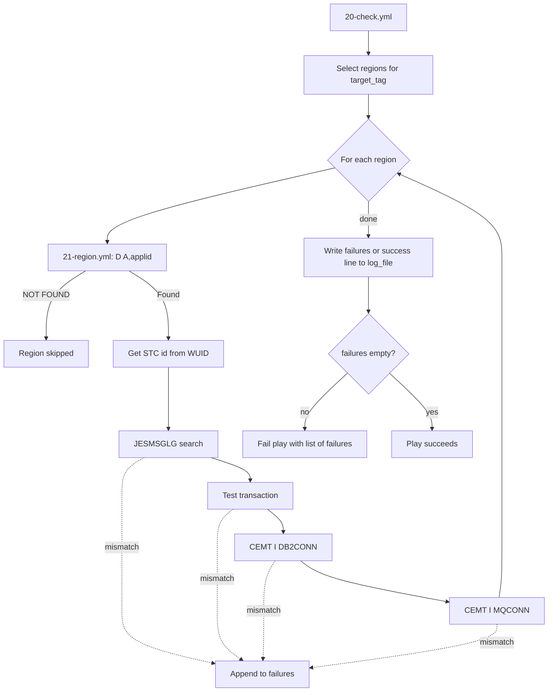

# CICS Region Health Check (Ansible)

Ansible playbook that checks the health of CICS regions on z/OS. For every region
defined under a chosen tag it can verify:

| Check | How it is done |
|---|---|
| Region is active | `D A,<applid>` operator command; "NOT FOUND" means the region is not running |
| Startup message | Reads the region's `JESMSGLG` and looks for a configured message (for example `DFHSI1517`) |
| Test transaction | Runs `F <applid>,<tran>` and checks the console output for an expected string |
| Db2 connection | Runs `F <applid>,CEMT I DB2CONN` and compares `Db2id(...)` with the expected Db2 SSID |
| MQ connection | Runs `F <applid>,CEMT I MQCONN` and checks `Connectst(Connected)` and that `Mqqmgr(...)` matches the expected queue manager |

All problems found are collected in one list, written to a local log file, and the
play fails at the end if the list is not empty.

## Files

| File | Purpose |
|---|---|
| [`20-check.yml`](20-check.yml) | Main playbook. Selects the regions for the requested tag, loops over them, writes the log and fails if anything failed |
| [`21-region.yml`](21-region.yml) | Task file included once per region. Runs the individual checks and appends to `failures` |
| [`22-ssc.yml`](22-ssc.yml) | Data file listing region tags, APPLIDs and the expected values for each check |
| [`inventory.yml`](inventory.yml) | z/OS hosts, SSH users and the z/OS environment variables required by ZOAU and Python |
| [`ansible.cfg`](ansible.cfg) | Ansible settings (inventory location, SSH options, explicit fact gathering) |

## Prerequisites

- Ansible on the control node, with SSH key access to the z/OS host(s).
- The `ibm.ibm_zos_core` collection (provides `zos_operator` and `zos_job_output`):
  ```bash
  ansible-galaxy collection install ibm.ibm_zos_core
  ```
- On z/OS: IBM Z Open Automation Utilities (ZOAU) and Python for z/OS. The paths used
  are set in `inventory.yml` (`ansible_python_interpreter`, `ZOAU_HOME`, `LIBPATH`, `PATH`).
- The SSH user must be allowed to issue the MVS operator commands used above
  (`D A`, and `F` to modify the CICS region) and to read the CICS job's spool output.
- CICS must accept `CEMT` commands from the MVS console (`F <applid>,CEMT ...`).

## Usage

Run from this folder so `ansible.cfg` is picked up:

```bash
cd cics_ansible
ansible-playbook 20-check.yml
```

Useful variants:

```bash
# Syntax check only (does not connect to z/OS)
ansible-playbook --syntax-check 20-check.yml

# Check a different tag
ansible-playbook 20-check.yml -e target_tag=MVS6.Engineering

# Write the log elsewhere
ansible-playbook 20-check.yml -e log_file=/var/tmp/cics_check.log
```

### Playbook variables

| Variable | Default | Description |
|---|---|---|
| `target_tag` | `MVS1.Engineering` | Tag in `22-ssc.yml` whose regions are checked |
| `log_file` | `/tmp/ansible_cics_log.txt` | Log file on the control node (written with `delegate_to: localhost`) |
| `failures` | `[]` | List that accumulates failure messages. Do not override |

The target host is set by `hosts:` at the top of `20-check.yml` (currently `zos_host2`).

## Defining regions (`22-ssc.yml`)

Regions are grouped under a usage tag. Each region entry supports these keys; every
key except `APPLID` is optional, and a check is only run when its keys are present:

```yaml
regiontags:
  - cicsts-RegionUsage:
      - Unique: "No"
      - UsageTag:
        - Tag: "MVS1.Engineering"      # must be the first item in the list
        - APPLID: "CICSTS64"           # also the job/STC name used by D A
          search: "DFHSI1517"          # string expected in JESMSGLG
          db2: True                    # enable Db2 check
          db2ssid: DBD0                # expected Db2 subsystem
          mq: True                     # enable MQ check
          mqssid: CSQ1                 # expected queue manager
          tran: IVC2                   # test transaction to run
          tranmsg: 'IVC2 Stopping'     # text expected in the response
        - APPLID: "CICSTS65"           # only the "region is active" check
```

Notes:
- The `Tag:` entry must be the first item of its `UsageTag` list. The playbook reads
  `UsageTag[0].Tag` to match the tag.
- `APPLID` is used as the name in `D A,<applid>`, so it must match the CICS job or started
  task name, not just the VTAM APPLID.
- Only the `cicsts-RegionUsage` list is read by the playbook. `cicsts-ApplUsage` is defined
  in the data file but not used yet.

## Flow



## Output

The log file contains one line per event:

```text
2026-11-11 10:15:02 zos_host2 ***Critical Error*** CICSTS64: MQ Connection CSQ1 not found to be connected
2026-11-11 10:20:41 zos_host2 No Errors found
```

The play result on the console is the list of failures. Exit status is non-zero when any
check fails.

## Known limitations

These are open points found while reviewing the playbook. They are listed here so
behaviour is not a surprise:

- **Region not found is not reported.** If `D A` returns "NOT FOUND" the region's checks
  are skipped and nothing is added to `failures`, so a region that is down can still end
  in "No Errors found".
- **Unexpected task errors stop the play.** A regex that does not match (for example
  `WUID=`, `Db2id(...)`), a missing JES job, or a failed operator command fails the host
  and skips the remaining regions and checks. Only the `assert` tasks use `ignore_errors`.
- **Missing values in CEMT output.** The `regex_search(...) | default('None') | first`
  pattern does not catch a non-match: `regex_search` returns `None`, which `default`
  does not replace unless `default(..., true)` is used.
- **Parsing console output is fragile.** CEMT responses are matched with regular
  expressions and depend on console formatting. The operator command wait time is the
  `zos_operator` default; slow responses can be truncated.
- **Unused data.** `cicsts-ApplUsage` entries in `22-ssc.yml` are not processed.
  `search_failed`, `db2con_failed`, `mqcon_failed` and `tran_failed` are per-region
  helper flags only.
- **`selected_usage` is undefined if no tag matches** `target_tag`, which gives an unhelpful
  error.

## Security notes

- `ansible.cfg` sets `UserKnownHostsFile=/dev/null` and `ForwardAgent=yes` in `ssh_args`.
  This weakens host key verification and exposes the SSH agent to the remote host. For
  anything other than a lab, use a real `known_hosts` file and remove agent forwarding.
- `remote_tmp = /tmp` is a shared directory on z/OS. Use a user-owned directory if possible.
- `inventory.yml` contains host addresses and user names. Do not commit real values to a
  shared repository. Keep them in a local or vaulted inventory and add it to `.gitignore`.
- No passwords or keys are stored in these files. Authentication is by SSH public key.
- The default log location is `/tmp`, which is readable by other users on the control
  node. Use a restricted directory for production use.

## Troubleshooting

| Symptom | Likely cause |
|---|---|
| Play stops at "Get STCID" | `D A,<applid>` output has no `WUID=`; the APPLID is not the job name |
| Search always fails | `JESMSGLG` does not contain the string yet, or the job id was not resolved |
| Transaction assertion fails | Console reply text differs from `tranmsg`, or the reply took longer than the wait time |
| Db2 or MQ check fails with `None` | `CEMT` output was not returned on the console or has a different layout |
| `ModuleNotFound` or ZOAU errors | Wrong `ansible_python_interpreter`, `ZOAU_HOME` or `LIBPATH` in `inventory.yml` |
