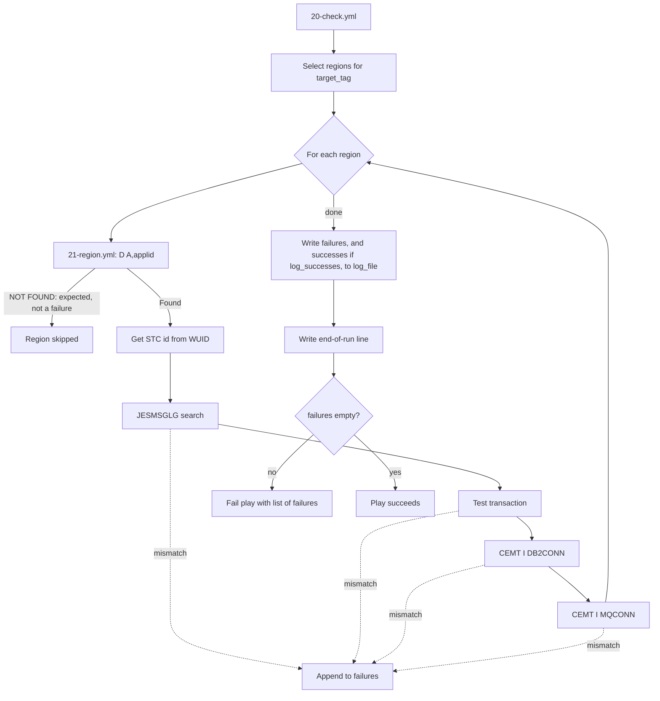

# CICS Region Health Check (Ansible)

Ansible playbook that checks the health of CICS regions on z/OS. For every region
defined under a chosen tag it can verify:

| Check | How it is done |
|---|---|
| Region is running | `D A,<applid>` operator command. A region that is not running ("NOT FOUND") is skipped and not treated as a failure (see below) |
| Startup message | Reads the region's `JESMSGLG` and looks for a configured message (for example `DFHSI1517`) |
| Test transaction | Runs `F <applid>,<tran>` and checks the console output for an expected string |
| Db2 connection | Runs `F <applid>,CEMT I DB2CONN` and compares `Db2id(...)` with the expected Db2 SSID |
| MQ connection | Runs `F <applid>,CEMT I MQCONN` and checks `Connectst(Connected)` and that `Mqqmgr(...)` matches the expected queue manager |

All problems found are collected in one list, written to a local log file, and the
play fails at the end if the list is not empty. Optionally, each successful check can
be logged as well (see `log_successes` below).

### Regions that are not running

A region that is not running is skipped on purpose and is **not** reported as a failure.
The playbook assumes that system automation decides which regions should be up and when,
so a region that is down is an expected state. It only checks regions that are running.
If you need to be told when a region that should be up is down, that has to be monitored
elsewhere, because this playbook will not report anything for it.

## Files

| File | Purpose |
|---|---|
| [`20-check.yml`](20-check.yml) | Main playbook. Selects the regions for the requested tag, loops over them, writes the log and fails if anything failed |
| [`21-region.yml`](21-region.yml) | Task file included once per region. Runs the individual checks and appends to `failures` |
| [`22-ssc.yml`](22-ssc.yml) | Data file listing region tags, APPLIDs and the expected values for each check |
| [`inventory.yml`](inventory.yml) | z/OS hosts, SSH users and the z/OS environment variables required by ZOAU and Python |
| [`ansible.cfg`](ansible.cfg) | Ansible settings (inventory location, SSH options, explicit fact gathering) |

## Prerequisites

- Ansible on the control node, with SSH key access to the z/OS host(s).
- The `ibm.ibm_zos_core` collection (provides `zos_operator` and `zos_job_output`):
  ```bash
  ansible-galaxy collection install ibm.ibm_zos_core
  ```
- On z/OS: IBM Z Open Automation Utilities (ZOAU) and Python for z/OS. The paths used
  are set in `inventory.yml` (`ansible_python_interpreter`, `ZOAU_HOME`, `LIBPATH`, `PATH`).
- The SSH user must be allowed to issue the MVS operator commands used above
  (`D A`, and `F` to modify the CICS region) and to read the CICS job's spool output.
- CICS must accept `CEMT` commands from the MVS console (`F <applid>,CEMT ...`).

## Usage

Run from this folder so `ansible.cfg` is picked up:

```bash
cd cics_ansible
ansible-playbook 20-check.yml
```

Useful variants:

```bash
# Syntax check only (does not connect to z/OS)
ansible-playbook --syntax-check 20-check.yml

# Check a different tag
ansible-playbook 20-check.yml -e target_tag=MVS1.Engineering

# Write the log elsewhere
ansible-playbook 20-check.yml -e log_file=/var/tmp/cics_check.log

# Also log every successful check
ansible-playbook 20-check.yml -e log_successes=true
```

### Playbook variables

| Variable | Default | Description |
|---|---|---|
| `target_tag` | `MVS6.Engineering` | Tag in `22-ssc.yml` whose regions are checked |
| `log_file` | `/tmp/ansible_cics_log.txt` | Log file on the control node (written with `delegate_to: localhost`) |
| `log_successes` | `False` | When true, each successful check is also written to the log. Values from `-e` such as `true` / `false` are converted with `| bool`, so they behave as expected |
| `failures` | `[]` | List that accumulates failure messages. Do not override |
| `successes` | `[]` | List that accumulates success messages (only filled when `log_successes` is true). Do not override |

The target host is set by `hosts:` at the top of `20-check.yml` (currently `zos_host`).
`inventory.yml` ships with placeholder values (`x.x.x.x`, `ssh_user`). Replace them with
your own host address and user before running.

## Defining regions (`22-ssc.yml`)

Regions are grouped under a usage tag. Each region entry supports these keys; every
key except `APPLID` is optional, and a check is only run when its keys are present:

```yaml
regiontags:
  - cicsts-RegionUsage:
      - Unique: "No"
      - UsageTag:
        - Tag: "MVS1.Engineering"      # must be the first item in the list
        - APPLID: "CICSTS64"           # also the job/STC name used by D A
          search: "DFHSI1517"          # string expected in JESMSGLG
          db2: True                    # enable Db2 check
          db2ssid: DBD0                # expected Db2 subsystem
          mq: True                     # enable MQ check
          mqssid: CSQ1                 # expected queue manager
          tran: IVC2                   # test transaction to run
          tranmsg: 'IVC2 Stopping'     # text expected in the response
        - APPLID: "CICSTS65"           # no checks configured, only looked up with D A
```

Notes:
- The `Tag:` entry must be the first item of its `UsageTag` list. The playbook reads
  `UsageTag[0].Tag` to match the tag.
- If several `UsageTag` entries use the same tag, the last one wins. Keep tags unique.
- `APPLID` is used as the name in `D A,<applid>`, so it must match the CICS job or started
  task name, not just the VTAM APPLID.
- Only the `cicsts-RegionUsage` list is read by the playbook. `cicsts-ApplUsage` is defined
  in the data file but not used yet.

## Flow



The start-of-run line is written before the regions are selected (not shown above).

## Output

Each run writes a start line, then the failures, then (if `log_successes` is true) the
successes, then an end line:

```text
2026-11-11 10:15:00 zos_host Start of Health Check Run for MVS1.Engineering
2026-11-11 10:15:02 zos_host ***Critical Error*** CICSTS64: MQ Connection CSQ1 not found to be connected
2026-11-11 10:15:02 zos_host Check Successful CICSTS64: Connected to Db2 Subsystem DBD0
2026-11-11 10:15:03 zos_host End of Health Check Run for MVS1.Engineering
```

- Failure lines are always written. `Check Successful` lines appear only when
  `log_successes` is true.
- The end line is written before the play fails, so it appears on failing runs too.
- A run with no failures and `log_successes` off leaves only the start and end lines.
- The play result on the console is the list of failures. Exit status is non-zero when
  any check fails.

## How failures are handled

- At the start of each region the per-region flags and values are reset (`Db2id`,
  `Mqqmgr`, `Connectst`, `cicslog`, the registered results), so one region cannot affect
  the next.
- A failed check (string not found, wrong Db2 SSID, MQ not connected, unexpected
  transaction output) appends one message to the shared `failures` list. The run then
  continues with the next check and the next region. The `assert` tasks use
  `ignore_errors` so a failed comparison does not stop the host.
- A check is recorded as a success only when it actually ran and matched. For Db2 and MQ
  that means the expected value was found in the CEMT output and the comparison passed,
  so a check that could not be evaluated is never logged as both a failure and a success.
- If `Db2id(...)`, `Mqqmgr(...)` or `Connectst(...)` cannot be found in the CEMT output,
  the value stays empty and the check is recorded as a failure instead of stopping the play.
- At the end every message is written to `log_file` and the play fails once with the full list.
- In the `when:` lists in `21-region.yml`, keep `region.mq` / `region.db2` as the first
  condition. Ansible evaluates the list in order and stops at the first false item, so
  this stops later conditions from reading output (`mqout.stdout`) that does not exist
  for regions without that check.

## Known limitations

These are open points found while reviewing the playbook. They are listed here so
behaviour is not a surprise:

- **Some task errors still stop the play.** These are not caught and fail the host, which
  skips the remaining checks and regions:
  - the `WUID=` lookup when the `D A` output has no match;
  - `zos_job_output` returning no job, or a failed `zos_operator` command.
- **Parsing console output is fragile.** CEMT responses are matched with regular
  expressions and depend on console formatting. The operator command wait time is the
  `zos_operator` default (1 second); slow responses can be truncated.
- **Unused data.** `cicsts-ApplUsage` entries in `22-ssc.yml` are not processed.
- **`selected_usage` is undefined if no tag matches** `target_tag`, which gives an unhelpful
  error.

## Security notes

- `ansible.cfg` sets `ForwardAgent=yes` in `ssh_args`, which exposes the SSH agent to the
  remote host. Remove it unless you need it. Host key checking uses the SSH defaults
  (`~/.ssh/known_hosts`); add the z/OS host key there before the first run.
- `remote_tmp = /tmp` is a shared directory on z/OS. Use a user-owned directory if possible.
- `inventory.yml` ships with placeholder values. Do not commit real host addresses or user
  names to a shared repository. Keep them in a local or vaulted inventory and add it to
  `.gitignore`.
- No passwords or keys are stored in these files. Authentication is by SSH public key.
- The default log location is `/tmp`, which is readable by other users on the control
  node. Use a restricted directory for production use.

## Troubleshooting

| Symptom | Likely cause |
|---|---|
| Play stops at "Get STCID" | `D A,<applid>` output has no `WUID=`; the APPLID is not the job name |
| Search always fails | `JESMSGLG` does not contain the string yet, or the job id was not resolved |
| Transaction assertion fails | Console reply text differs from `tranmsg`, or the reply took longer than the wait time |
| Db2 or MQ failure is logged although the connection is up | `CEMT` output was not returned on the console, was truncated, or has a different layout from `Db2id(...)` / `Mqqmgr(...)` / `Connectst(...)` |
| `ModuleNotFound` or ZOAU errors | Wrong `ansible_python_interpreter`, `ZOAU_HOME` or `LIBPATH` in `inventory.yml` |
| Host key verification failed | The z/OS host key is not in `~/.ssh/known_hosts` |
